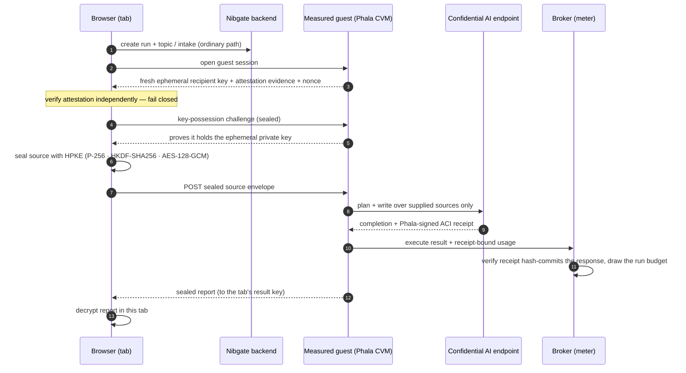

import { Callout } from 'nextra/components'

# Confidential runs

An ordinary Dr. Nib run sends your supplied document and the report through Nibgate's servers. A **confidential run** is the alternative: the document, the model's reading of it, and the finished report are processed only inside a **measured confidential VM** (a Phala dstack CVM), and never exist as plaintext on the Nibgate backend or broker. The two sides hold ciphertext and metadata only.

The topic and the intake answers you type stay on the ordinary backend — that text is not the sensitive part. What is sealed is the **supplied source**, the **model's reading of it**, and the **report**.

<Callout type="info">
Confidential runs are an **opt-in preview**, not the default. A build must explicitly enable the flow *and* ship a reviewed attestation configuration; if either is missing the flow fails closed back to the ordinary pipeline. There is no completed live confidential run yet, and the mode is not enabled on mainnet. Figures here describe the implemented path, not a shipped guarantee — see `dr-nib/CONFIDENTIAL-IMPLEMENTATION.md` for the current checkpoint.
</Callout>

## The flow, end to end

 1. **Create** — the run and its topic/intake are created on the ordinary backend, exactly like a normal run. Nothing private has left the browser yet.
 2. **Guest session** — the browser asks the guest for a **fresh** ephemeral encryption key, independent attestation evidence, and a nonce. A reused or stale key is refused.
 3. **Attestation** — the browser verifies the quote, the measured compose hash, the workload image, and the TCB before releasing anything. A mismatch aborts the run.
 4. **Key possession** — a quote that merely *contains* a key hash does not prove the guest holds the key, so the browser challenges it and the guest must prove possession of the ephemeral private key.
 5. **Seal the source** — the source is encrypted in the browser to that key with HPKE. The authenticated data binds tenant, run, object, revision, purpose, and the recipient-key digest, so a ciphertext cannot be replayed onto another run or recipient.
 6. **Process** — inside the measured guest the existing Dr. Nib stage pipeline runs over the **supplied sources only** (live web and server-side tool calls are off). Prompts go to a confidential model endpoint with attested routing and zero-data-retention constraints; an unconstrained call is not an attested call.
 7. **Meter** — the model returns a Phala-signed ACI receipt. The receipt does not embed token counters, but it hash-commits the response body, so the guest's reported cost is bound to the signature by hash. The broker validates that binding and draws the run's budget.
 8. **Report** — the report is sealed to the browser's result key and decrypted in the tab. The result key and worker-state key live in tab memory only.

## What each side can see

| Party | Sees |
|---|---|
| Browser tab | The plaintext source, the attestation evidence, the decrypted report, and the keys — nothing else holds them |
| Nibgate backend | Ciphertext envelopes, run metadata, tenant/run IDs, object digests |
| Broker (meter) | Ciphertext, receipt-bound usage, budget movement — never the source or report |
| Measured guest | The plaintext, in memory, only while it is running; keys are released only to the verified enclave |
| Confidential AI endpoint | The prompt the guest sends, under attested routing + ZDR constraints |

## Money and budgets

A confidential run uses the same [budget and escrow](/dr-nib/budgets) machinery as an ordinary run — the same ledger, the same cap, the same pause-never-overspend rule. The difference is only *where the work runs* and *how it is metered*: the guest reports receipt-bound usage, and the broker draws the run's allowance through an internal, HMAC-protected route that only the broker can call. A run that cannot present a valid receipt-backed usage is not discounted.

## Limits and honest posture

- **Supplied sources only.** Live web, cloud OCR, and server-side tool calls are disabled; the source is a single supplied file or pasted text. Live-web-in-the-enclave is a later phase.
- **Bounded work.** At most three model calls, up to 1,200 output tokens, a prompt cap, and a source of up to 100,000 characters (2 MB per file).
- **Attestation verifies the *environment*, not the *browser*.** A confidential claim also needs an independently verified, pinned client and key policy — a browser that Nibgate can silently re-serve is not yet operator-blind. This is why the mode is a preview.
- **Receipts bind the counters, not the enclave's honesty.** The adapter requires the response bytes to match the receipt's committed `body_hash`; it does not assert that the provider never inflates the figure, only that the figure is the one the signed receipt covers.

## References

- Backend: `dr-nib/backend/src/privacy/` (`guard.js`, `phala-aci-adapter.js`, `phala-ai-port.js`, `private-guest-main.js`, `private-broker.js`, `private-money-route.js`).
- Frontend: `frontend/src/lib/dr-nib-private-*.ts`, `frontend/src/components/dr-nib/ConfidentialRun.tsx`.
- Design: `dr-nib/CONFIDENTIAL-IMPLEMENTATION.md`, `dr-nib/CONFIDENTIAL-AI-BUDGET.md`, `dr-nib/PHALA-VERIFIER.md`.
