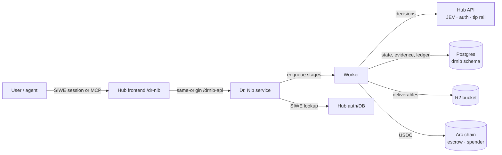
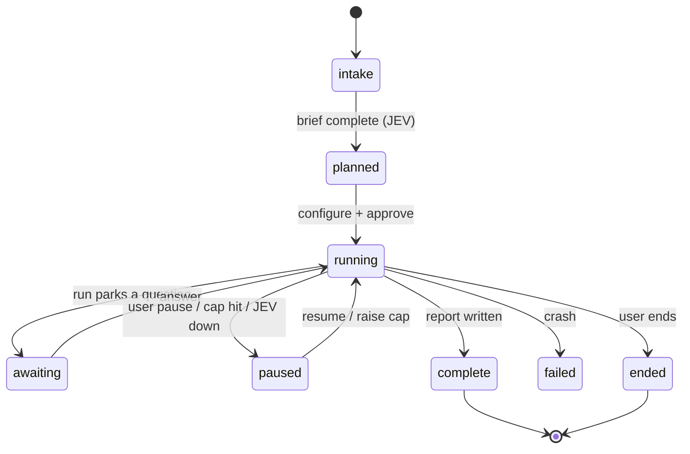

import { Callout } from 'nextra/components'

# Protocol & architecture

Dr. Nib is a research agent *and* the protocol underneath it: a budgeted, auditable agent that buys what it needs, inside policy, and can be commissioned by other agents. This page is the box-and-arrow view — the services, the run lifecycle, the money rails, and where each guarantee is enforced.

## The pieces

- **Hub frontend** — the `/dr-nib` UI (research, projects, sources, help). It talks to the service through a same-origin proxy so the hub's session cookie just works.
- **Dr. Nib service** — the Express API plus the worker that runs pipeline stages. It has no accounts of its own: identity is the hub's wallet session.
- **Hub API** — the decision seat (JEV), and the rails the agent spends through (tip challenge/verify, x402).
- **Postgres** — runs, evidence, claims, reports, and the append-only ledger, in the service's own `drnib` schema.
- **R2** — rendered deliverables and private supplied-source originals. Originals use `nibgate-research`, with `testnet/` and `mainnet/` object prefixes, no public bucket domains, and owner-authenticated downloads.
- **Arc** — the onchain guarantees: run escrow and the spend mandate.

**Reference:** `dr-nib/backend/src/server.js`, `routes/`, `worker.js`, `db.js`, `env.js`; `dr-nib/ARCHITECTURE.md`.

## Identity is the wallet

There is no Dr. Nib login. The browser API reads the hub's SIWE session cookie and validates it against the hub's own `Session`/`User` tables (`HUB_DATABASE_URL`) using the same code path the hub uses. Mutating routes verify ownership; supported idempotency keys protect retried requests, and stage checkpoints prevent duplicate charging. MCP uses a trusted service key: its caller names the owner wallet, but the wallet string is not a signature or a separate authentication check. Keep the key only in trusted server-side integrations; give individual users the session-authenticated browser API.

## The run lifecycle

Stages are durable: state checkpoints to Postgres, the worker is stateless and survives restarts, and the event feed is replayable by `seq` — a client that disconnects at step five reconnects at step six. Pause is cooperative (checked between steps); the run outlives the HTTP request that started it.

<Callout type="info">
**JEV down ≠ model decides.** If the decision seat is unreachable, the run parks with `pauseReason: 'jev'` and the balance untouched. It resumes when the seat is back. See [How JEV decides](/dr-nib/jev).
</Callout>

## The two loops

1. **Intake loop** — batched questions (5 per screen, 8 total), each answer folded into a living brief. JEV owns the stop rule (`proceed` / `ask_more` / `reframe`); the 8-question cap can override with a visible `cap hit` label.
2. **Research loop** — per round: search → fetch → score → review. The data stage adds a propose → judge → execute loop (model proposes tools, JEV decides, tools execute). Termination is enforced in code with explicit budgets and stop reasons, never requested in prompt prose. See [Agent loop](/dr-nib/agent-loop).

## Money, and where it's enforced

The ledger is the source of truth; contracts are the guarantee:

| Layer | Enforces | Where |
|---|---|---|
| Ledger | per-stage drawdown, 1% fee, raise-only caps (never past the onchain deposit), settle/refund | `dr-nib/backend/src/money.js`, `budgets` |
| Software caps | per-call ceilings, run-balance gate, verdict binding, dual-RPC | `spend/policy.js`, `spend/guard.js` |
| Spend mandate | onchain daily cap + recipient allowlist for direct transfers | `NibgateSpender` (Arc testnet) |
| Run escrow | the deposited budget (≥ estimate, one-shot) locked onchain, atomic split at settle | ERC-8183 core + `NibgateRunSplitter` (funded lifecycle verified on Arc testnet and mainnet) |

A run never overspends — it pauses at the cap and asks. On one-shot escrow deposits an exhausted run ends (report kept) or restarts bigger as a new run. The remainder returns at settle. Both public network apps require escrow; ledger-only mode is for development. See [Budgets & refunds](/dr-nib/budgets), [Onchain escrow](/dr-nib/escrow), and [Spending gates](/dr-nib/gates).

## Machine parity

Dr. Nib is agent-facing as well as people-facing. Its MCP server exposes run tools (`answer_question`, `approve_plan`, `pause_run`, `reprompt_run`, `reconcile_run`, …) with escrow and budget gates. The MCP key grants trusted service-level authority over runs for any named wallet; it must never be embedded in a browser or handed to an untrusted agent. Production refuses MCP calls when no key is configured. Only local development permits keyless calls with a warning. The Dr. Nib server card (version 0.2.5) includes research availability; this is separate from the hub MCP registry. Paid calls use USDC from the run budget within per-call ceilings. If the planner's model is unavailable, a fallback outline is labeled and cannot be escrow-funded; configure again to retry planning.

There are **two separate MCP servers**: the published Nibgate Hub MCP at `https://api.nibgate.xyz/mcp` provides creator, content, and payment tools; the Dr. Nib research MCP is at `https://nibgate.xyz/drnib-api/mcp` (direct service: `https://drnib.nibgate.xyz/mcp`). The Dr. Nib route has a public read-only server card, but its JSON-RPC tools require the private service key. It is not the Hub server's published MCP Registry listing, and a browser user's SIWE session does not authorize its MCP tools. Testnet uses `https://testnet.nibgate.xyz/drnib-api/mcp`.

## Deliverables

All new report exports return authenticated inline/base64 downloads, including reports based only on a typed brief. Research reports are not published to the public media CDN. Copied report links are account links requiring the owner's sign-in; public report sharing is not implemented.

## Supplied-source API and MCP

Owner-authenticated routes: `GET` and `POST /v1/runs/:id/sources`; `GET /v1/runs/:id/sources/:sourceId` for extracted text; `GET /v1/runs/:id/sources/:sourceId/original` for original bytes; `DELETE /v1/runs/:id/sources/:sourceId` to exclude an input before execution. POST accepts `{name, contentBase64}` or `{url}`. Browser clients use the same-origin `/drnib-api` prefix. Downloads are private and uncached.

Dr. Nib MCP 0.2.5 provides `attach_source`, `list_supplied_sources` and `read_supplied_source`, including OCR for PNG/JPEG/WebP source images. Calls require the trusted service key and a run whose wallet matches the supplied `ownerWallet`; that match is a consistency check, not independent wallet authentication. Supply `ownerWallet` and `runId`, plus file input or `sourceId` as applicable. The hub MCP/OpenAPI version is independent and unchanged.

Settled budgets cannot fund a reprompt. Start a fresh project and fund a new deposit; upload its inputs again. An active stage drains before End refunds the remainder.

A finished run keeps its research as raw markdown and generates deliverables from it, never by re-running: **Markdown, JSON (+escrow receipt block), BibTeX, PDF, Word, Excel (+escrow columns on Ledger), PowerPoint**. Binary formats are rendered by the service and returned as base64 through the authenticated API; text formats come back inline. The format is chosen *after* the research exists — choosing a format before there is anything to export is guessing. Reports carry a coverage badge + claim×source matrix from the verify pass, and have version-pinned account links. Sources are numbered in an immutable per-report snapshot so browser citations and exports keep the same mapping.
