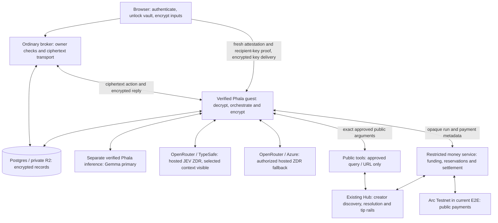

# Dr Nib privacy architecture

Updated 20 October 2026. This describes the implemented owner-scoped private
flow and explicitly identifies production proposals. It authorizes no deployment,
Git push, spending increase or public cutover. See [STATUS.md](STATUS.md) for
release evidence and [PRODUCTION.md](PRODUCTION.md) for worker lifecycle and rollout.

## Product and trust boundary

Use the existing Dr. Nib screens with client encryption underneath. Sensitive
research must not fall back to ordinary uploads, chat or model execution when
private processing is unavailable. The default public product has not been cut
over: the tested build is localhost, one authorized tenant, backed by real Phala.
Existing plaintext projects do not become private merely by changing the UI.

“Private” means encrypted ordinary storage and verified confidential processing,
with explicit exceptions for hosted JEV, authorized Azure/OpenRouter ZDR research fallback and approved external tool arguments.
It does not mean anonymity, no metadata, provider-blind JEV or hidden model
chain-of-thought disclosure. Client delivery and approved-release governance
remain part of the trust boundary.

## End-to-end composition

The model is not installed on our CPU guest. The guest orchestrates research and
calls separate inference services. Stopping our guest does not stop a GPU model
that we rent; this architecture uses API inference, not a dedicated rented GPU.

## Component ownership and permitted visibility

| Component | Responsibility | Permitted readable data |
| --- | --- | --- |
| Browser | Encrypt/decrypt, vault recovery, worker verification, approvals | User documents, project keys, report and private chat |
| Ordinary auth/broker | Login, ownership, ciphertext APIs and capabilities | Identity, opaque IDs, lifecycle, timing and sizes; no content keys |
| Confidential guest | Parse/OCR, intake, plan, bounded propose → JEV judge → execute, write/verify, discussions and exports | Decrypted project content during authorized processing |
| Confidential inference | Required generation/analysis prompts through the pinned verified route | Required prompt and generated output inside that inference environment |
| Hosted JEV | Actual TypeSafe decisions, probabilities and scores | Selected judgment context visible to OpenRouter and TypeSafe; ZDR is a retention policy |
| Authorized hosted fallback | Azure GPT-4o mini through pinned OpenRouter ZDR | Required research context visible to OpenRouter/Azure; provider-reported usage, not attested inference |
| Public tools / Hub | Search, fetch, creator detection, recipient resolution | Approved public queries, URLs, public content and necessary payment metadata |
| Money service | Confirmed funding, charge admission, tool payments and refunds | Amounts, model/token usage, opaque references and chain receipts; no document bodies or vault keys |
| Postgres / R2 | Durable state and large objects | Ciphertext plus minimal authorization, coordination and financial metadata |

Questions, filenames, titles, plans, source text, citations, findings, progress
explanations and discussion history are private content too. Account identity,
chain activity, timing, sizes and aggregate usage remain visible metadata.

## Models and decisions

The current reviewed hybrid guest uses `phala/gemma-4-26b-a4b-uncensored` as its verified Phala primary. Measured policy `phala-openrouter-zdr-canary-v1` can select `openai/gpt-4o-mini` pinned to Azure through OpenRouter when the approved recovery/admission rules permit it. Required ZDR, denied collection, provider pinning and disabled implicit fallbacks remain enforced. The client discloses provider visibility before execution and identifies actual hosted responses in encrypted activity. A hosted response is accounted as provider-reported, never relabeled hardware-attested. Strict confidential mode remains a distinct policy. See [PHALA-MODELS.md](PHALA-MODELS.md).

The CPU guest orchestrates rather than hosting model weights. Receipt/session evidence identifies confidential serving; a catalog label alone is insufficient. The real funded primary report passed. A later exact-image local forced-fallback workflow passed with real Azure/JEV and no new unknown provider outcome; it was not a forced-failure test on the remote CVM. Neither establishes a provider SLA.

Actual `typesafe/jev-1.13-20260917` is called directly by the guest through the
native OpenRouter/TypeSafe Decisions route. Provider routing is fixed, mandatory
ZDR is requested and fallback is disabled. The inspected workspace had prompt
logging and external broadcast disabled. The measured configuration binds the
workspace/review policy; the point-in-time review expires after 24 hours. This
needs production freshness handling. The ordinary Hub is not a private JEV proxy.
OpenRouter and TypeSafe receive readable selected context; do not call JEV
attested or provider-blind. Its usage is accounted rather than a confidential
inference proof. See [ATTESTATION.md](ATTESTATION.md) and [BUDGET.md](BUDGET.md).

Encrypted activity contains model-authored action explanations, JEV decisions,
tool observations and sampled source-support checks. These are inspectable work
records, not a promise to expose hidden internal reasoning. The local candidate
shows concise findings/next steps as normal Dr. Nib messages and moves operational
retrieval notes into chat. Scientific uncertainty stays in the report. The new
writer policy is in the reviewed 20 October guest image and passed the recorded funded report and local forced-fallback checks; see [STATUS.md](STATUS.md).
Source-support checks
do not establish that every claim is true or that a report is high quality.

## Keys, storage and device recovery

The browser creates random vault and project material. A wallet address or login
signature is not an encryption secret. An enrolled browser keeps protected vault
access in IndexedDB; encrypted project-key wrappers and manifests synchronize
through ordinary authenticated APIs. A separately saved random recovery code
allows another browser to unlock the vault after normal account authentication.

Recovery-code replacement from an enrolled device atomically updates the recovery
record and all project wrappers, including deleted projects, while preserving
project seeds and content. The owner confirmed replacement and isolated Chrome
Incognito recovery with existing projects. A physical second device remains
untested. Passkey PRF and trusted-device pairing are not implemented. Losing all
enrolled devices and recovery material makes the retained ciphertext unrecoverable.

Original uploads, extracted content, checkpoints, events, manifests, reports,
private discussions and exports are encrypted before external persistence.
Large encrypted objects use private R2; coordination and bounded encrypted records
use Postgres. Authenticated envelope context binds tenant/run/object/purpose and
revision as applicable. No public object URL or plaintext filename is required.
Only the approved guest receives project processing keys through a fresh verified
session. Current client-assisted recovery must not be described as unattended
background key recovery: see the production lifecycle document.

Opening saved projects and reading completed reports requires browser decryption,
not a model call or running Phala guest. Deletion and retention must account for
backups and object versions; immediate eradication of every copy is not promised.

## Tools and external disclosure

| Tool class | Execution and boundary |
| --- | --- |
| Supplied-source parsing/OCR and evidence analysis | Inside the reviewed guest; no ordinary parsing fallback or external OCR |
| Public search / fetch | Existing retrieval registry/public-tools service sees the exact approved public query or URL; private uploads/history are not sent |
| Creator discovery | Existing Hub metadata discovery with relevance-tie preference and wider-web fallback; generated extension detector is reused in a bounded public worker, not duplicated inside Phala |
| Paid article / API access | Exact destination/request and amount approval, independent money admission, durable result/payment journal |
| Creator tips | Used/cited eligible original work, bounded remaining budget and research reserve; JEV proposes an affordable amount, exact owner approval precedes transfer |
| Terminal | Real Bash/Python/Node/curl under pinned gVisor; bounded files/resources, no worker secrets/sockets or direct Internet; approved HTTP responses supplied through exact-request cache |
| Follow-ups / exports | Private route; remotely rendered exports are encrypted by the guest before persistence/delivery; cached reading is not new inference |

A TEE tool can still disclose content through an outbound request. Deterministic
argument/destination/redirect/network checks enforce the boundary independently
of the model. New queries, destinations, bodies and payments need their applicable
approval. A source-only instruction cannot silently become web research. Rendered
reports do not execute source HTML or automatically load remote report images.

A tip held in the Hub claimbox is described as deposited for creator claim,
not already received in the creator wallet. The actual tests proved held-tip
funding, not creator claim/release. See [CREATOR-DISCOVERY.md](CREATOR-DISCOVERY.md).

## Durable workflow, billing and failure recovery

Research state is durable ciphertext, not the VM's process memory. Per-action
leases and encrypted checkpoints record completed work. Stale owners are fenced.
Known completed model/tool results are reused; a started operation without a
proven result stays uncertain and retains its reservation. “Retry” must not
repeat a possibly charged operation. Temporary failures park the same funded
run rather than automatically ending and refunding it. Owner questions and tool
approvals are explicit waiting states, distinct from failure or completion.

Funding must be chain-confirmed before customer research admission. A separate
restricted service owns keeper/payment capability; the guest has no keeper key.
Budget admission includes actual usage plus unresolved commitments. Receipts
separate cumulative model totals, individual expenses, sponsorship, reservations,
charges and refunds. Settlement freezes customer charges and refunds unused
escrow. A late provider result cannot increase a frozen customer bill.

The guest reads a narrow financial metadata view for export receipts rather
than raw payment proofs. Read-only export failures do not relabel a completed
research project as paused or reopen settled escrow. Same-request export recovery
is limited to matching requests with no inference operation. See [PROTOCOL.md](PROTOCOL.md)
for precise action, lease and envelope contracts.

## Release verification and deployment

Pin clean base/runtime/container digests, measured policy and inference route.
Current release checks reject more than 100 filesystem layers; the clean tested
image has 21. An independent full dstack verification precedes the short-lived
reviewed browser boot manifest. The browser verifies fresh quote measurements,
nonce/session binding and live recipient-key possession before releasing keys.
Unexpected measurements, expiry or changed releases fail closed.

The local fixed-boot manifest deliberately does not accept arbitrary reboots or
new instances. The new local durable wake controller does not change that browser trust root.
Production scale-to-zero needs reviewed release verification that
accepts fresh legitimate boots without trusting guest-supplied allowlists or
silently blessing replacement code. Mutable client delivery also needs an
explicit independently verifiable release policy. Do not solve wake failures by
disabling measurement checks. [PRODUCTION.md](PRODUCTION.md) records these gates.

## Evidence and remaining work

Passed owner E2Es on real Phala cover funded research, checkpoint continuation,
authorized paid creator delivery, a positive held creator tip, settlement/refund,
receipts and browser exports. Latest checks: 348 privacy tests, 62 disposable
Postgres workflow tests, TypeScript, 368 image source/schema/import checks,
independent boot verification and four native terminal checks. The exact releases,
amounts and limitations are in [STATUS.md](STATUS.md).

The new lifecycle candidate adds isolated PostgreSQL load/kill tests and a real
Phala wake/automatic-idle-stop measurement, recorded in
[LIFECYCLE-ACCEPTANCE-2026-10-20.md](LIFECYCLE-ACCEPTANCE-2026-10-20.md). These remain
bounded tests rather than a completed production stress/soak or multi-tenant
capacity benchmark. General-user provisioning/cutover,
legacy plaintext handling, physical-device/Google/alternative-wallet acceptance,
creator claim/release, representative quality/latency and production lifecycle
load/chaos tests remain open. A successful single-owner E2E does not close them.

## Existing systems and lessons

Primary documentation and public repository descriptions reviewed online on 18 October 2026. These are architecture precedents, not an independent security audit or evidence that Dr. Nib already satisfies their guarantees.

### Tinfoil confidential tools

Tinfoil publishes [confidential-websearch](https://github.com/tinfoilsh/confidential-websearch), an enclave-hosted MCP server exposing search and fetch backed by Exa. Its documented flow optionally masks query PII, calls the external provider, optionally screens returned content for prompt injection, and returns results. It also provides deterministic local fixtures. This is the closest concrete tool implementation reference for Dr. Nib.

Its [security FAQ](https://tinfoil.sh/security-and-privacy-faq#5-web-search-page-fetch-and-map-lookups) explicitly says queries and URLs reach outside providers, ZDR agreements are contractual, PII filtering is incomplete, and queries can identify a user even without an account ID. Thus a confidential tool runtime does not make an external search provider blind. This limits the privacy claim even when the entire tool call originates inside a TEE.

### Tinfoil durable storage

The [confidential-sync repository](https://github.com/tinfoilsh/confidential-sync) describes a stateless enclave that authenticates users, accepts client-held keys, encrypts backups with user/scope/blob binding, and persists ciphertext. Its [storage sidecar tutorial](https://docs.tinfoil.sh/containers/persistent-storage) gives a second concrete pattern: AES-GCM encryption inside the enclave before S3 writes, with client-supplied keys and durable client recovery. These are precedents for retaining our existing Postgres/R2 infrastructure while encrypting application payloads before persistence.

### IronClaw tool permissions

[NEAR AI's IronClaw](https://github.com/nearai/ironclaw) documents WASM-isolated untrusted tools, explicit host/path permissions, host-bound credential injection, resource limits and leak scanning. Its default local deployment is not automatically a remotely attested confidential service. The reusable lesson is an execution-layer permission boundary independent of the model, not a requirement to rewrite Dr. Nib in Rust. Pattern matching for credentials cannot prove that arbitrary document-derived prose is safe to disclose.

### Proton Lumo processing and history

[Lumo's security model](https://proton.me/blog/lumo-security-model) separates client-to-inference encryption from user-only encryption of saved history. Its [privacy policy](https://proton.me/lumo/privacy-policy) explicitly allows optional simplified requests to search partners. This is a useful product precedent for distinguishing stored-content confidentiality from processing and tool disclosures; it is not evidence of an equivalent attested-worker boundary.

### Apple release verification

[Apple Private Cloud Compute](https://security.apple.com/blog/private-cloud-compute/) describes client key release to attested nodes whose measurements match publicly logged releases, with inspectable production images. The applicable principle is that clients verify a release before releasing data. A provider-controlled client or allowlist that silently accepts replacement code is insufficient for our stronger operator-blind goal. This is a reference principle, not an Apple service we can deploy Dr. Nib onto.

