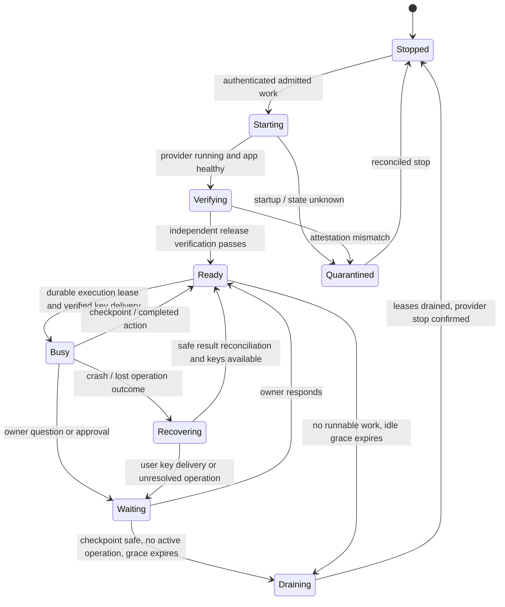

# Production worker lifecycle and rollout

Design recommendation, 20 October 2026. This is a proposed production contract,
not enabled infrastructure or authorization to deploy/spend. The tested guest
is owner-scoped and stopped. See [ARCHITECTURE.md](ARCHITECTURE.md),
[STATUS.md](STATUS.md) and [ATTESTATION.md](ATTESTATION.md).

## Local candidate acceptance update (20 October)

The durable controller, explicit wake/status routes, background lease-aware idle
stop and independent watchdog entrypoint are implemented locally. A real Phala
cycle measured 56.926 seconds to app readiness, 79.292 seconds through independent
verification/possession, and automatic stop 43.109 seconds after the final warm
request with a 15-second test grace. The recommended production grace remains
five minutes. See [lifecycle acceptance](LIFECYCLE-ACCEPTANCE-2026-10-20.md) for
404 privacy/client checks, 72 database tests, isolated load/kill evidence, exact
limitations and remaining canary provisioning. Later proposal text below remains
planning context where it describes features beyond this owner-scoped candidate.

## Read-only deployment review — 20 October 2026

The live mainnet Railway inventory still starts the ordinary Dr. Nib API (`start:prod`) and ordinary worker. The separate synthetic broker and QA verifier services are test infrastructure, not a configured production private stack. No changes were staged or deployed during review.

Concrete gates: production-specific roles/storage/secrets and release preparation; separate broker/funding/watchdog entrypoints; dedicated funding listener (the prepared private profile binds 0.0.0.0); online-verifier browser/broker policy and CORS/TLS pins; renewed 24-hour hosted-policy review; explicit cumulative runtime renewal; production-origin auth/recovery and fresh-boot acceptance. Mainnet paid-source support now uses a separate default-off enable flag, an explicit per-operation ceiling, canonical network/Hub/Gateway matching and network-bound Circle reconciliation. Its local tests pass; deployment and real-money smoke tests remain separately unauthorized. Single-owner canary can precede general multi-tenant admission; it cannot silently expand to additional accounts.

Recommended sequence: local preparation → owner-only real-hosting canary with Arc Testnet money → restart/fallback/settlement acceptance → reviewed cohort → separately approved mainnet activation. Rollback blocks new private admissions, preserves encrypted reads/checkpoints/escrow, reconciles money and drains/stops; never route a private run to ordinary plaintext processing. See [PLAN.md](PLAN.md) for the current checklist.

### Planning estimates, not authorization

The current prepared shape is `tdx.medium` (2 vCPU / 4 GB) at **$0.116 per active hour**, plus a retained 20 GB disk at **$0.00278/hour** ($0.06672/day, approximately $2.0016 per 720-hour month). This replaces the earlier small-instance planning estimate. Sleep stops compute billing; retained disk continues billing.

The current control/verifier/database planning assumption is 2 GB average RAM plus 0.25 average vCPU in aggregate: approximately $0.034665/hour or $25 per month at published Railway rates, before database volume, egress, frontend, AI, R2, taxes and subscription minimums. Actual usage has not been measured. See [the cost worksheet](../../ops/dr-nib-canary/costs.json) and [deployment review](../../ops/dr-nib-canary/REVIEW.md).

The proposed $5 incremental testnet-canary allowance is not approved. It is a planning allowance, not a provider-side hard billing cap or a mainnet payment authorization. Historical development limits remain separate. Mainnet requires a separate reviewed configuration and real-money spending limit; the testnet-only paid-source guard must not be bypassed with a network-variable substitution.

## Recommended first deployment

Keep a small ordinary control plane available for authentication, ciphertext
storage/delivery, durable job admission and lifecycle coordination. It cannot
decrypt research. Use a shared pool of CPU Phala workers with bounded execution
slots; do not provision a VM per visitor or host a dedicated GPU for our models.
Start with one production canary worker and explicit capacity limits. General-user
tenant isolation/provisioning must replace today's test-owner restriction first.

Opening Dr. Nib, listing projects, reading reports, receiving encrypted progress
or checking an action's status should not wake a worker. A submitted AI action
(intake, planning, research, discussion or a new uncached export) triggers wake.
A cached export can be delivered from encrypted storage without waking. Optional
authenticated composer-focus prewarming is a later latency/cost experiment, not
the default for every page view. Rate-limit admission and speculative wake requests.

Use a five-minute idle grace period initially, measured from the last eligible
work ending. This is a product recommendation, not a measured optimum or current
production setting. Keep a warm worker through rapid follow-ups; stop only when
no queued dispatch, active operation or recovery obligation requires it. Tune
using observed arrival gaps, start latency and paid running minutes.

## Lifecycle

1. Persist a bounded encrypted action and opaque coordination record under the
   original request ID. The browser retains keys. Check ownership, rate limits,
   capacity, funding and budget before dispatch; waking does not authorize spend.
2. One elected lifecycle controller starts an existing provisioned worker.
   Concurrent requests share that start rather than issuing duplicate starts.
   Return a durable pending status instead of making one browser HTTP request
   wait through the whole boot. UI shows starting/verifying and reconnects.
3. Verify provider state, app readiness and independently approved release policy.
   The browser still verifies fresh evidence and recipient-key possession itself.
   Health checks or a provider “running” flag never authorize key release.
4. Assign a durable fenced execution lease. Recover encrypted checkpoints and
   proven results before doing new work. A worker failure must not replay unknown
   paid operations or settle/refund a resumable run automatically.
5. Keep the VM running while a model/payment operation is in flight. Long owner
   waits can checkpoint and release capacity; a heartbeat/status poll is not
   billable agent work and must not keep an idle VM alive forever.
6. Drain before stopping: exclude new assignment, check the shared durable lease
   state, checkpoint and quiesce work, release memory keys, request shutdown and
   confirm stopped. Work arriving during drain queues for the next safe boot.
7. An independent watchdog reconciles controller crashes, stale leases, provider
   state and spending limits. An in-process timer alone is not a reliable hard
   cost cap. Unknown start/stop outcomes quarantine assignment until reconciled.

## Where state and keys live

| State | Durable location / recovery |
| --- | --- |
| Documents, reports, chat, progress and checkpoints | Encrypted Postgres/private R2; available while compute is stopped |
| Funding, usage commitments and execution ownership | Durable minimal financial/lease metadata; separate restricted money service |
| User vault access | Enrolled browser plus user-held recovery code; encrypted wrappers synchronize |
| Live processing keys / working plaintext | Authorized guest memory; not an ordinary database or queue field |
| Worker state, start/stop generation and scheduling | PostgreSQL lifecycle records and provider reconciliation in the local candidate; independent watchdog supervision is a deployment step |

Do not depend on VM disk or RAM as the only copy of research state. Phala's
retained disk is useful for pinned binaries/caches, but application recovery
must work from authenticated encrypted checkpoints after a replacement worker.

**Current key limitation:** a fresh worker needs the user's browser to verify it
and deliver processing keys. A job already running may continue while the tab is
closed if its guest remains alive and its keys are in memory; that behavior still
needs explicit deployed acceptance. After a crash/stop loses those keys, preserve
the funded checkpoint and ask the client to reconnect. Do not advertise guaranteed
unattended restart while the user is offline.

A later fully autonomous mode could use an expiring project-key capsule sealed
to an approved TEE/KMS release policy. It would need tenant/action binding, replay
and rollback controls, revocation, expiry, deletion and independent upgrade
approval. This is not implemented and must not give the operator a master
recovery key. It is a separate privacy design, not a shortcut to shipping wake.

## What exists versus what must change

| Concern | Current implementation | Production requirement |
| --- | --- | --- |
| Start/stop adapter | Official Phala SDK lifecycle adapter | Scoped credentials and reconciled provider state |
| Wake controller | Shared DB intents, request leases, readiness/attestation, idle/runtime accounting and quarantine | Deploy migration/grants and independently supervise the watchdog |
| Job ownership | Durable action/checkpoint leases | Current candidate checks durable guest execution leases as well as HTTP leases; general worker-pool assignment remains future work |
| Readiness | No-wake availability plus explicit authenticated wake/status | Deployed browser/canary acceptance |
| Runtime budget | Durable cumulative runtime window across replicas | Reviewed quota-window renewal, provider bill reconciliation and hard external cost controls |
| Key release | Reviewed fixed-boot browser manifest and fresh possession proof | Fresh-boot release verification without manual repinning or weakened checks |
| Tenants | Explicit single test-owner restriction | Authorized multi-tenant admission/isolation and shared capacity bounds |
| Scaling | One already-provisioned CVM | Queue limits, fair scheduling, measured concurrency and reviewed worker registration |

Relevant code: `phala-durable-wake.js`, `private-lifecycle-store.js`, `phala-wake-watchdog.js`, `phala-wake-bootstrap.js`,
`phala-lifecycle-api.js`, `private-broker-wake.js`, `private-broker-config.js`,
`private-action-store.js` under `dr-nib/backend/src/privacy/`. Unit tests of these
controllers are not proof of live distributed lifecycle correctness. The latest lifecycle benchmark exercised real on-demand start and automatic
idle stop with independent full verification, zero model/payment calls and no
project keys. It does not establish production browser key release after restart.

## Wake time and user experience

A clean same-image stopped-to-app/verified-ready cycle is now recorded in the
acceptance document. App readiness was about 57 seconds and independently verified
readiness about 79 seconds. The warm verified path took 13 seconds with the local
Docker verifier. These are not model-answer latency or a p95. Measure more cycles
and the deployed independent verifier before selecting an SLA.

Zero idle compute and guaranteed instant first replies cannot both be promised.
A warm CPU worker avoids VM startup; scale-to-zero trades idle savings for cold
start delay. Model inference has its own latency even while the worker is warm.
If the cold p95 is unacceptable, keep one small worker warm during expected
traffic hours or continuously, and scale additional workers with demand. Do not
pick an arbitrary “fast wake” number or confuse the five-minute idle grace with
boot duration. Test on the deployed canary before setting a customer SLA.

## Infrastructure and customer budget

[Phala CPU pricing](https://cloud.phala.com/about/pricing), checked 20 October
2026, says CPU compute is billed by running minute and stops when the provider
receives the stop request; retained disk remains billed while stopped. The listed
storage rate is $0.000139/GB/hour, approximately $2/month for the minimum 20 GB.
These terms concern CPU CVMs; dedicated GPU rentals have different commitments.
Inference API usage is a separate cost.

Track running minutes, retained GB-hours, inference, public API/creator spending,
customer charges and refunds separately. Current customer receipts mark CVM
compute/storage operator-funded, not metered per run. A future disclosed compute
meter must reserve within the user's cap and allocate a shared machine interval
at most once across concurrent runs. Cold starts, idle grace, deployment failures
and debugging must not silently become customer charges. Provider bill lag is
not a license to invoice estimates as actual usage. See [BUDGET.md](BUDGET.md).

## Release and test sequence

Targeted real E2Es passed. Full stress/soak/multi-tenant capacity acceptance has
not. Use deployment realism without risking general-user workloads:

| Stage | Environment | Required evidence |
| --- | --- | --- |
| Correctness / recovery | Disposable local DB and isolated deployed test worker | Concurrency fencing, hostile inputs, wrong tenant/key, duplicate actions, unknown model/payment outcomes, quota boundaries |
| Stress / soak / chaos | Isolated deployment matching intended production topology, bounded spend and synthetic/testnet identities | Gradual concurrent load, queue/backpressure, prolonged stability, broker/guest crashes, partitioned provider APIs, no duplicate charges or lost checkpoints |
| Production canary | Restricted real production origins, allowlisted users, conservative caps | Real Google/wallet login, device recovery, CORS/cookies, fresh-boot verification, live wake/idle-stop, deployed latency and receipt reconciliation |
| Gradual rollout | Small explicit traffic cohorts | Observability and rollback with ciphertext/checkpoints/escrow preserved; expand only on measured acceptance |

Do not start uncontrolled stress tests on the shared production service. Real
payment smoke tests require explicit amounts/recipients and budget; this document
authorizes none. Do not change chain/network or point synthetic data at customer
storage to make a test look production-like.

Required lifecycle cases include concurrent wake (one start), startup failure,
attestation failure (no key delivery), broker crash mid-start, lease expiry and
stale worker fencing, new request during drain, long owner wait, browser close,
restart with/without user keys, provider stop failure, payment result uncertainty,
monthly/run budget exhaustion and two tenants unable to access each other's
state. Verify zero unintended model/payment replays and no content in logs,
queue/control rows or public-tool arguments.

Before broad activation, also settle the legacy plaintext-project policy,
client/release governance, fresh JEV policy-review handling, creator claim/release
acceptance and quality/latency targets. Do not relabel historical plaintext data
or a hosted ZDR model as provider-blind confidential processing.

## Primary provider references

- [Phala Cloud pricing](https://cloud.phala.com/about/pricing)
- [Phala CVM API: start, stop and state](https://docs.phala.network/phala-cloud/references/cloud-api-beta/cvm)
- [Phala documentation](https://docs.phala.com/phala-cloud)
